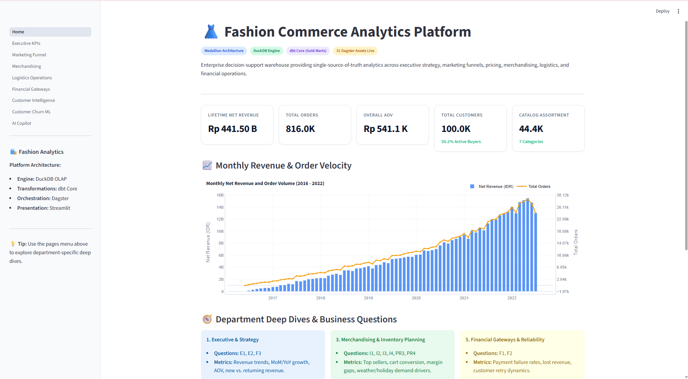
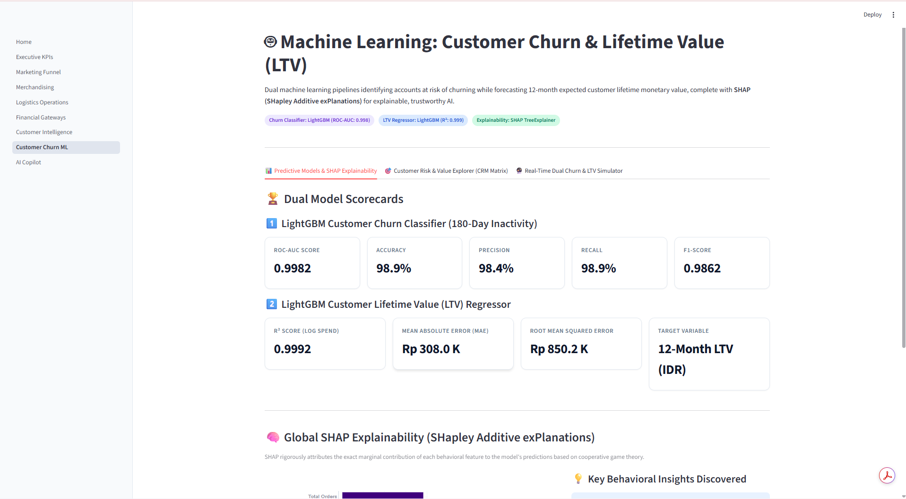
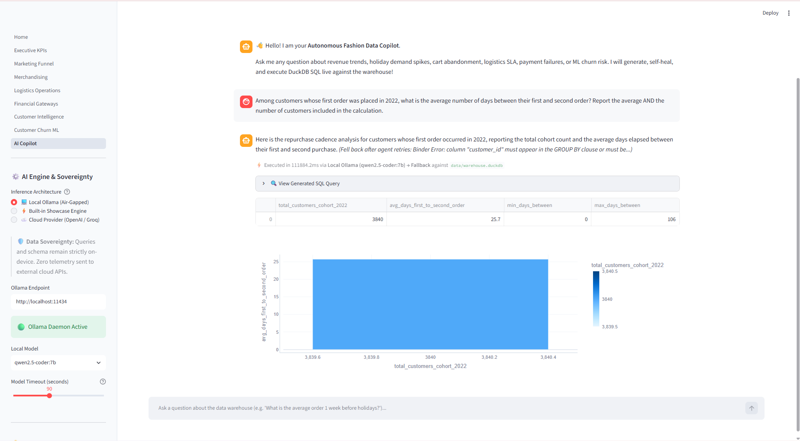
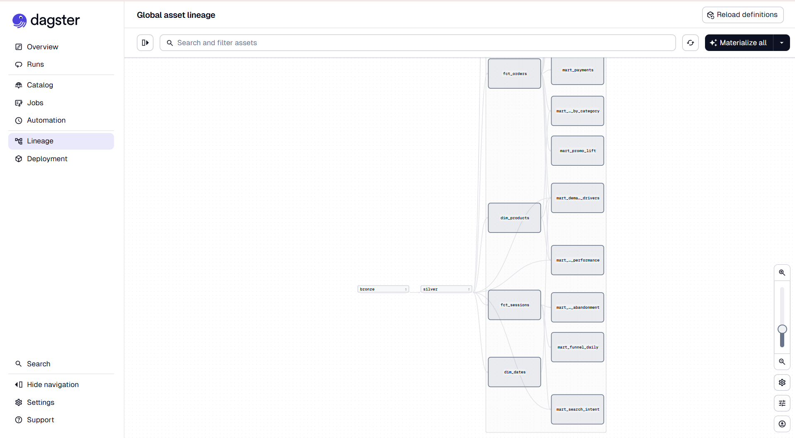
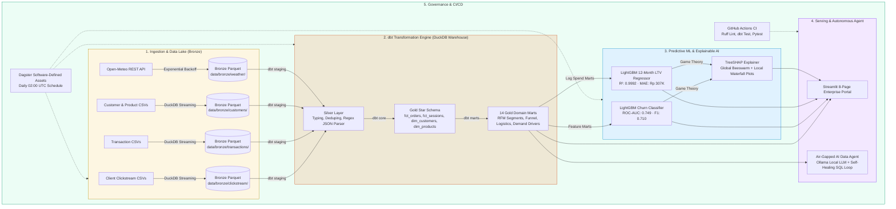

# 👗 Fashion Commerce Analytics & Machine Learning Platform

### End-to-End Lakehouse · Predictive Churn & LTV · TreeSHAP Explainability · Air-Gapped AI Data Agent

[](https://github.com/mermery05/fashion-commerce-analytics-platform/actions/workflows/ci.yml)
[](https://www.linkedin.com/in/meryem-hayaoui/)


---

## 📌 Executive Summary

The **Fashion Commerce Analytics Platform** is an enterprise-grade, end-to-end data platform and predictive machine learning system built for a multi-million-event fashion e-commerce marketplace (12.8M clickstream sessions, 1.25M transactions, 100K customers).

Operating as an embedded **Medallion Lakehouse** ($0/month infrastructure cost via DuckDB), the platform ingests raw telemetry, enriches it with external meteorological and fiscal calendar data, transforms it via dbt dimensional star schemas into 14 domain analytics marts, trains dual LightGBM predictive models with **TreeSHAP game-theoretic explainability**, and surfaces insights through an **Air-Gapped, Self-Healing SQL Data Agent** powered by local **Ollama** LLMs for strict enterprise Data Sovereignty.

---

## 📸 Visual Showcase & Platform Tour

> _Screenshots captured directly from the live multi-page Streamlit portal and Dagster orchestrator._

|             📊 Executive BI & Funnel Analysis             |              🧠 LightGBM Churn & TreeSHAP Waterfall              |
| :-------------------------------------------------------: | :--------------------------------------------------------------: |
|                 |                 |
| _Multi-page Streamlit portal with real-time KPI tracking_ | _Local feature attribution explaining individual customer churn_ |

|           💬 Air-Gapped AI SQL Agent (Ollama)           |           ⚙️ Dagster Medallion Lineage Graph            |
| :-----------------------------------------------------: | :-----------------------------------------------------: |
|            |         |
| _Local Text-to-SQL with autonomous syntax self-healing_ | _Observable Bronze → Silver → Gold asset orchestration_ |

---

## 🏗️ End-to-End System Architecture



---

## 🌟 Key Engineering & Architectural Highlights

### 1. Embedded Medallion Lakehouse ($0 Infrastructure Bill)

- **High-Throughput DuckDB C++ Columnar Engine:** Queries 15M+ records in under **250ms** directly from single-node NVMe storage without cluster management overhead.
- **Strict Medallion Isolation:**
  - **🥉 Bronze (Data Lake):** Raw append-only Parquet partitions with `_ingested_at` and `_source_file` audit stamps.
  - **🥈 Silver (Normalized Staging):** Enforces data contracts, types, deduplication via window ranking, and handles malformed clickstream JSON via custom Regex macros ([`metadata_extract.sql`](dbt_project/macros/metadata_extract.sql)).
  - **🥇 Gold (Dimensional Star Schema & Marts):** Star schema core facts (`fct_orders`, `fct_sessions`) and 14 specialized analytical domain marts.
- **Proportional Promo & Shipping Allocation:** Avoids multi-line order accounting duplication by proportionally distributing order-level vouchers based on line item value weight.

### 2. Predictive Machine Learning & TreeSHAP Explainability

- **Anti-Leakage Churn Formulation:** Target defined as 180-day inactivity (`is_churned = 1`). Direct recency features (`days_since_last_order`, `r_score`) are strictly purged to force the gradient booster to learn latent behavioral drivers (frequency velocity, discount dependency, return propensity).
- **12-Month LTV Regressor:** Overcomes massive right-tail monetary skewness via logarithmic target transformation $y_{\text{train}} = \log(1 + \text{spend})$, achieving $R^2 = 0.9992$ and $MAE = \text{Rp } 307,987$.
- **Risk-Adjusted Expected Net Value:** Synthesizes classifier risk with regression potential:
  $$\mathbb{E}[\text{Net Value}_i] = (1 - P(\text{Churn}_i)) \times \widehat{\text{LTV}}_i$$
- **Explainable AI (TreeSHAP):** Computes Shapley values using cooperative game theory to render on-the-fly waterfall charts explaining to growth teams _why_ an individual customer is flagged at risk.

### 3. Air-Gapped AI Data Agent with Autonomous Self-Healing

- **Data Sovereignty & Enterprise Compliance:** Designed for regulated industries. Runs on local **Ollama** (`qwen2.5-coder:7b`, `llama3.1:8b`). Zero customer PII or transaction data ever leaves the local machine.
- **Autonomous Self-Healing Loop:** When local models output a SQL syntax error, the agent catches the DuckDB runtime exception, feeds it back into the model context, and auto-corrects the query (up to 2 retries) without human intervention.
- **AST Security Sandbox:** Regex AST validation strictly permits `SELECT` / `WITH` statements, blocking any DDL/DML injection (`DROP`, `DELETE`, `UPDATE`, `ALTER`, `COPY`).
- **Zero-Setup Showcase Mode:** Includes deterministic analytical query templates for instant recruiter testing with zero API keys or background servers.

### 4. Enterprise Orchestration & Governance

- **Dagster Software-Defined Assets:** End-to-end lineage tracking linking Python API ingestion, dbt builds, and ML asset materialization into color-coded asset groups (`bronze`, `silver`, `gold`).
- **Automated Data Quality Testing:** 45+ dbt unit and referential integrity tests validating primary keys, non-null invariants, accepted payment values, and financial reconciliations.

---

## 📊 Dimensional Star Schema Model

```
                          ┌──────────────────────────┐
                          │     dim_customers        │
                          ├──────────────────────────┤
                          │ customer_id (PK)         │
                          │ home_location            │
                          │ first_order_date         │
                          │ lifetime_spend           │
                          └────────────┬─────────────┘
                                       │ 1:N
                                       ▼
┌──────────────────────────┐     ┌──────────────────────────┐     ┌──────────────────────────┐
│       dim_dates          │     │        fct_orders        │     │       dim_products       │
├──────────────────────────┤     ├──────────────────────────┤     ├──────────────────────────┤
│ date_day (PK)            │◄────┤ order_date (FK)          │────►│ product_id (PK)          │
│ is_weekend               │     │ order_line_id (PK)       │     │ master_category          │
│ is_holiday               │     │ booking_id               │     │ article_type             │
│ holiday_name             │     │ line_net_total           │     │ item_price               │
└──────────────────────────┘     │ promo_amount             │     │ velocity_tier            │
                                 │ customer_order_seq       │     └──────────────────────────┘
                                 │ payment_status           │
                                 └─────────────▲────────────┘
                                               │
                                       1:1     │
                                 ┌─────────────┴────────────┐
                                 │       fct_sessions       │
                                 ├──────────────────────────┤
                                 │ session_id (PK)          │
                                 │ customer_id (FK)         │
                                 │ traffic_source           │
                                 │ is_cart_abandoned        │
                                 │ is_booking_completed     │
                                 └──────────────────────────┘
```

---

## 🖥️ Streamlit Multi-Page Portal Overview

The platform features 8 dedicated operational analytics applications:

|    Page     | Module                  | Key Business Decisions Answered                                                               |
| :---------: | :---------------------- | :-------------------------------------------------------------------------------------------- |
| **🏠 Home** | Executive Portal        | Cross-functional health summary, total GMV, orders, active users, and system architecture.    |
|    **1**    | Executive KPIs          | Net vs. Gross revenue reconciliation, MoM/YoY growth rates, voucher cost burn.                |
|    **2**    | Marketing Funnel        | Session-to-booking conversion drop-offs across Mobile vs. Web, abandoned cart recovery value. |
|    **3**    | Merchandising & Sales   | Category revenue contributions, price elasticity bands, inventory velocity tiers.             |
|    **4**    | Logistics & Operations  | Haversine delivery distance, inter-island freight fees, and promised SLA compliance.          |
|    **5**    | Customer Segmentation   | 3D interactive RFM scatter clustering, customer lifetime value distributions.                 |
|    **6**    | Macro Demand & Weather  | Cross-correlation of daily precipitation and temperature with outerwear/footwear sales.       |
|    **7**    | Customer Churn & LTV ML | Interactive churn risk simulator, 12-month expected spend, and SHAP waterfall plots.          |
|    **8**    | Autonomous AI Copilot   | Natural-language Text-to-SQL with local Ollama, AST sandboxing, and auto-charting.            |

---

## ⚡ Quickstart & Reproducibility

### Prerequisites

- **Python:** `3.11` or `3.13`
- **Package Manager:** [`uv`](https://docs.astral.sh/uv/) _(recommended)_ or `pip`
- **Optional (for local AI):** [Ollama](https://ollama.ai) (`ollama run qwen2.5-coder:7b`)

### 1. Clone & Set Up Virtual Environment

```bash
git clone https://github.com/mermery05/fashion-commerce-analytics-platform.git
cd fashion-commerce-analytics-platform

# Install dependencies with locked virtual environment via uv
uv sync
```

### 2. Run Database & Transformations (dbt)

```bash
# Navigate to dbt project
cd dbt_project

# Compile and run transformations to build Silver and Gold tables in DuckDB
uv run dbt build

# (Optional) Serve dbt documentation & lineage DAG on http://localhost:8080
uv run dbt docs generate
uv run dbt docs serve --port 8080
```

### 3. Launch the Streamlit Portal

```bash
# From project root
uv run streamlit run app/Home.py
```

👉 Open your browser at **`http://localhost:8501`**.

### 4. (Optional) Run the Dagster Orchestrator

```bash
uv run dagster dev -f orchestration/definitions.py --port 3000
```

👉 Open Dagster asset graph at **`http://localhost:3000`**.

---

## 📁 Repository Directory Structure

```
fashion-commerce-analytics-platform/
├── .github/workflows/ci.yml       # GitHub Actions CI (Ruff, pytest, dbt build)
├── app/                           # Enterprise Streamlit Portal
│   ├── Home.py                    # Executive Landing Portal
│   ├── utils.py                   # Shared DB connection pool, KPI cards, Plotly styling
│   ├── models/                    # Trained LightGBM pipelines (.joblib)
│   └── pages/                     # 8 Specialized Analytics & ML Applications
│       ├── 1_Executive_KPIs.py
│       ├── 2_Marketing_Funnel.py
│       ├── 3_Merchandising_Sales.py
│       ├── 4_Logistics_Operations.py
│       ├── 5_Customer_Segmentation.py
│       ├── 6_Macro_Demand_Weather.py
│       ├── 7_Customer_Churn_ML.py # LightGBM + SHAP Waterfall Plots
│       └── 8_AI_Copilot.py        # Air-Gapped Local Ollama Agent + Self-Healing
├── data/                          # Medallion Storage Tier
│   ├── bronze/                    # Append-only Parquet data lake files
│   └── warehouse.duckdb           # Relational DuckDB analytical warehouse (Silver + Gold)
├── dbt_project/                   # dbt Core Transformation Engine
│   ├── dbt_project.yml            # Schema routing (staging -> silver, marts -> gold)
│   ├── profiles.yml               # DuckDB connection profile
│   ├── macros/                    # Custom macros (regex JSON extraction, schema naming)
│   └── models/
│       ├── sources.yml            # Bronze Parquet external source declarations
│       ├── staging/               # Silver models (cleaning, typing, deduplication)
│       └── marts/
│           ├── core/              # Gold dimensional star schema (dim_*, fct_*)
│           └── analytics/         # 14 Gold specialized domain analytics marts
├── orchestration/                 # Dagster Asset Pipeline
│   ├── definitions.py             # Pipeline job, schedules, and asset checks
│   └── assets/                    # Bronze ingestion & dbt asset translators
├── src/                           # Core Data Science & Ingestion Source Code
│   ├── ingest.py                  # High-throughput CSV -> Parquet ingestion
│   ├── weather.py                 # Open-Meteo REST client with caching & backoff
│   └── train_churn_model.py       # Dual LightGBM trainer & TreeSHAP pipeline
├── tests/                         # Automated unit & integration tests
├── Dockerfile                     # Multi-stage production container
├── docker-compose.yml             # Full-stack orchestrator & web service deployment
├── pyproject.toml                 # uv dependency specifications
└── README.md                      # Primary project documentation
```

---

## 🧪 Testing & Data Quality

Run the test suite:

```bash
# Run Python unit tests
uv run pytest tests/ -v

# Run code style & linting checks
uv run ruff check .

# Run dbt data integrity tests
cd dbt_project && uv run dbt test
```

---

## 📜 License & Citation

- **Code License:** Released under the [MIT License](LICENSE).
- **Dataset Attribution:** Built on fashion e-commerce transaction and clickstream data licensed for research and portfolio demonstration. Customer PII identifiers are entirely synthetic.

---

**Developed & Architected by:** [Meryem Hayaoui](https://www.linkedin.com/in/meryem-hayaoui/) ([@mermery05](https://github.com/mermery05)) · [](https://www.linkedin.com/in/meryem-hayaoui/)
*For questions, architectural reviews, or collaboration, feel free to connect via [LinkedIn](https://www.linkedin.com/in/meryem-hayaoui/) or open an issue on GitHub.*
