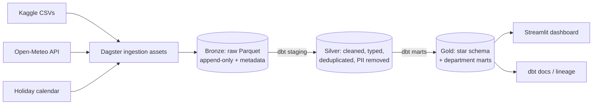

# fashion-commerce-analytics-platform

End-to-end lakehouse analytics: DuckDB + dbt + Dagster

# Fashion Commerce Analytics Platform

> An end-to-end lakehouse for a fashion e-commerce app: raw events and orders become governed, tested data marts that answer the questions each business team asks every day.


**[Live dashboard](streamlit-url)** · **[Data lineage & docs](github-pages-url)** · **[Architecture decisions](docs/adr/)**

<!-- Hero GIF: Dagster run -> dbt lineage -> dashboard -->


---

## 1. Business context

A fashion marketplace app generates four streams of data: registered **customers**, a **product** catalog, **transactions** (orders with payment, promo and shipping details) and **clickstream** events (every screen interaction per session). Teams across the company need a single trusted source for decisions on pricing, marketing, merchandising, logistics, finance and customer retention.

This platform ingests the raw data, enriches it with **weather** (Open-Meteo API) and **calendar/holiday** data, models it into a **star schema**, and serves department-specific marts to a dashboard.

## 3. Key findings

<!-- Fill in with real numbers after analysis. Examples of the format: -->

- Sales rise sharply in the 5 days before a holiday, peaking 2 days prior. _(I3)_
- New customers use promos most heavily in their first month, long-term customers far less. _(PR2)_
- `<x>%` of sessions that reach add-to-cart never complete a booking. _(P3)_

## 4. Architecture



| Layer      | Contents                                                                                                                       | Rules                    |
| ---------- | ------------------------------------------------------------------------------------------------------------------------------ | ------------------------ |
| **Bronze** | Exact copies of sources plus `_ingested_at`, `_source_file`                                                                    | No cleaning, append-only |
| **Silver** | One model per source: typed, deduplicated, nested JSON flattened, PII dropped                                                  | No business joins        |
| **Gold**   | `fct_orders`, `fct_sessions`, `dim_customer`, `dim_product`, `dim_date`, `dim_location_weather` and the department marts above | Metrics defined once     |

**Stack:** DuckDB (engine) · dbt-core + dbt-duckdb (transformations, tests, docs) · Dagster (orchestration, lineage, checks) · Docker Compose · GitHub Actions · Streamlit. Why these tools: see [ADR-0001](docs/adr/0001-why-duckdb.md).

## 5. Data model

Star schema with two facts (`fct_orders` at order-line grain, `fct_sessions` at session grain) and shared dimensions. See the [dbt docs site](github-pages-url) for the lineage graph and column-level documentation, and [`docs/data_dictionary.md`](docs/data_dictionary.md).

## 6. Data quality & governance

- **dbt tests:** unique and not-null keys, accepted values (event names, payment status, gender), referential integrity between facts and dimensions, non-negative amounts.
- **Reconciliation:** gold revenue reconciles to silver totals.
- **Dagster asset checks:** row count and freshness per bronze asset.
- **PII policy:** names, emails, usernames and device IDs are dropped in silver and never reach gold.
- **CI:** lint, unit tests and `dbt build` on every pull request.

## 7. Quick start

```bash
git clone https://github.com/<you>/<repo>.git && cd <repo>
make setup        # install dependencies and git hooks
make download     # fetch the dataset (requires a Kaggle API token)
make up           # Dagster UI at http://localhost:3000
make dbt-build    # build silver and gold and run tests
make app          # dashboard at http://localhost:8501
```

Prerequisites: Python 3.11, [uv](https://docs.astral.sh/uv/), Docker, and a [Kaggle API token](https://www.kaggle.com/docs/api).

## 8. Project structure

```
orchestration/   Dagster assets, checks, schedules
dbt_project/     staging (silver) and marts (gold) models, tests
src/             reusable Python (API clients, helpers)
app/             Streamlit dashboard
notebooks/       exploratory analysis
docs/            architecture, ADRs, data dictionary
tests/           unit tests
```

## 9. Roadmap

- [ ] Incremental models for orders and events
- [ ] Anomaly detection on daily KPIs
- [ ] Optional PySpark + Delta Lake variant of the silver layer for comparison

## 10. Dataset & license

Data: Fashion e-commerce transactions and clickstream dataset from [Kaggle](kaggle-url), licensed **CC BY-NC-ND** and intended for study and portfolio use only. The data is not redistributed in this repository; use `make download`. All customer identifiers in the source are synthetic.

Code in this repository is released under the [MIT License](LICENSE).

## 11. Author

**<Your name>** · [LinkedIn](url) · [Portfolio](url)
