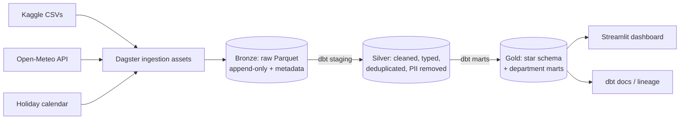

# fashion-commerce-analytics-platform

End-to-end lakehouse analytics: DuckDB + dbt + Dagster

# Fashion Commerce Analytics Platform

> An end-to-end lakehouse for a fashion e-commerce app: raw events and orders become governed, tested data marts that answer the questions each business team asks every day.


**[Live dashboard](streamlit-url)** · **[Data lineage & docs](github-pages-url)** · **[Architecture decisions](docs/adr/)**

<!-- Hero GIF: Dagster run -> dbt lineage -> dashboard -->


---

## 1. Business context

A fashion marketplace app generates four streams of data: registered **customers**, a **product** catalog, **transactions** (orders with payment, promo and shipping details) and **clickstream** events (every screen interaction per session). Teams across the company need a single trusted source for decisions on pricing, marketing, merchandising, logistics, finance and customer retention.

This platform ingests the raw data, enriches it with **weather** (Open-Meteo API) and **calendar/holiday** data, models it into a **star schema**, and serves department-specific marts to a dashboard.

## 2. Business questions by department

Every dbt mart and dashboard page maps to a question below.

### Executive / Strategy

| #   | Question                                                               | Decision supported                 | Mart                   |
| --- | ---------------------------------------------------------------------- | ---------------------------------- | ---------------------- |
| E1  | How are revenue, orders, AOV and active customers trending (MoM, YoY)? | Quarterly targets, board reporting | `mart_exec_kpis`       |
| E2  | What share of revenue comes from new vs. returning customers?          | Growth vs. retention investment    | `mart_exec_kpis`       |
| E3  | Which countries and regions drive revenue and growth?                  | Market prioritization              | `mart_geo_performance` |

### Marketing

| #   | Question                                                                      | Decision supported                 | Mart                    |
| --- | ----------------------------------------------------------------------------- | ---------------------------------- | ----------------------- |
| M1  | Which traffic source (mobile vs. web) converts best from session to purchase? | Channel budget allocation          | `mart_funnel_daily`     |
| M2  | What do users search for, and which searches lead to no purchase?             | SEO, campaign themes, catalog gaps | `mart_search_intent`    |
| M3  | How do customer cohorts retain over 1, 3, 6 and 12 months?                    | Lifecycle campaigns                | `mart_cohort_retention` |
| M4  | How large is each RFM segment and what is its revenue share?                  | Targeted offers, win-back          | `mart_rfm_segments`     |

### Product / Growth (App Experience)

| #   | Question                                                                                       | Decision supported         | Mart                    |
| --- | ---------------------------------------------------------------------------------------------- | -------------------------- | ----------------------- |
| P1  | Where do sessions drop off (home → search → item detail → add to cart → booking)?              | UX fixes, A/B test backlog | `mart_funnel_daily`     |
| P2  | How do session length and events per session differ by device and source?                      | App performance priorities | `fct_sessions`          |
| P3  | What is the add-to-cart to paid-booking rate, and how much revenue is lost to abandoned carts? | Cart recovery features     | `mart_cart_abandonment` |

### Pricing & Promotions

| #   | Question                                                                              | Decision supported         | Mart                       |
| --- | ------------------------------------------------------------------------------------- | -------------------------- | -------------------------- |
| PR1 | What is the promo lift (order value, conversion) by promo code?                       | Keep, tweak or kill a code | `mart_promo_lift`          |
| PR2 | Do new customers rely on promos more than long-term customers?                        | Acquisition discount depth | `mart_promo_lift`          |
| PR3 | What is the gross-to-net revenue gap (promo cost as a share of revenue) per category? | Margin protection          | `mart_pricing_by_category` |
| PR4 | How do price points per article type relate to units sold?                            | Price-band strategy        | `mart_pricing_by_category` |

### Merchandising & Inventory Planning

> The dataset has no stock levels, so these questions use demand signals as a proxy for inventory decisions.

| #   | Question                                                                                         | Decision supported                              | Mart                       |
| --- | ------------------------------------------------------------------------------------------------ | ----------------------------------------------- | -------------------------- |
| I1  | Which categories, article types and colours are top sellers, and which are slow movers?          | Assortment and buy planning                     | `mart_product_performance` |
| I2  | What is the view-to-cart-to-purchase rate per product (products viewed often but rarely bought)? | Delist, reprice or re-photograph                | `mart_product_performance` |
| I3  | How does demand shift by season, holiday and weather (e.g. temperature, rain)?                   | Seasonal stock build-up, demand forecast inputs | `mart_demand_drivers`      |
| I4  | Which brands and colours gain or lose share over time?                                           | Supplier negotiations                           | `mart_product_performance` |

### Logistics & Fulfillment

| #   | Question                                                                                   | Decision supported                         | Mart             |
| --- | ------------------------------------------------------------------------------------------ | ------------------------------------------ | ---------------- |
| L1  | How do shipment fees vary by destination, and what share of order value do they represent? | Shipping pricing, free-shipping thresholds | `mart_logistics` |
| L2  | What is the distribution of shipment deadlines (promised delivery windows) by region?      | Carrier SLAs                               | `mart_logistics` |
| L3  | How far do orders travel (distance from customer home to shipment location)?               | Warehouse placement                        | `mart_logistics` |

### Finance & Payments

| #   | Question                                                             | Decision supported               | Mart             |
| --- | -------------------------------------------------------------------- | -------------------------------- | ---------------- |
| F1  | What is the payment success vs. failure rate by payment method?      | Payment provider mix             | `mart_payments`  |
| F2  | How much revenue is lost to failed payments, and do customers retry? | Retry flows, provider escalation | `mart_payments`  |
| F3  | What are net revenue, promo cost and shipping revenue per month?     | Monthly close, forecasting       | `mart_exec_kpis` |

### Customer Success & CRM

| #   | Question                                                                            | Decision supported        | Mart                   |
| --- | ----------------------------------------------------------------------------------- | ------------------------- | ---------------------- |
| C1  | Which customers are active, at risk or lapsed (180-day inactivity definition)?      | Retention campaigns       | `mart_customer_status` |
| C2  | What are repeat purchase rates and time between orders?                             | Replenishment reminders   | `mart_customer_status` |
| C3  | What does the lifetime value distribution look like by segment, gender and country? | Acquisition cost ceilings | `mart_rfm_segments`    |

### Data Platform (internal)

| #   | Question                                             | Decision supported  | Mart                       |
| --- | ---------------------------------------------------- | ------------------- | -------------------------- |
| D1  | Is each source fresh, complete and valid today?      | Trust in dashboards | dbt tests + Dagster checks |
| D2  | How many rows were rejected at ingestion per source? | Upstream data fixes | Bronze metadata            |

## 3. Key findings

<!-- Fill in with real numbers after analysis. Examples of the format: -->

- Sales rise sharply in the 5 days before a holiday, peaking 2 days prior. _(I3)_
- New customers use promos most heavily in their first month, long-term customers far less. _(PR2)_
- `<x>%` of sessions that reach add-to-cart never complete a booking. _(P3)_

## 4. Architecture



| Layer      | Contents                                                                                                                       | Rules                    |
| ---------- | ------------------------------------------------------------------------------------------------------------------------------ | ------------------------ |
| **Bronze** | Exact copies of sources plus `_ingested_at`, `_source_file`                                                                    | No cleaning, append-only |
| **Silver** | One model per source: typed, deduplicated, nested JSON flattened, PII dropped                                                  | No business joins        |
| **Gold**   | `fct_orders`, `fct_sessions`, `dim_customer`, `dim_product`, `dim_date`, `dim_location_weather` and the department marts above | Metrics defined once     |

**Stack:** DuckDB (engine) · dbt-core + dbt-duckdb (transformations, tests, docs) · Dagster (orchestration, lineage, checks) · Docker Compose · GitHub Actions · Streamlit. Why these tools: see [ADR-0001](docs/adr/0001-why-duckdb.md).

## 5. Data model

Star schema with two facts (`fct_orders` at order-line grain, `fct_sessions` at session grain) and shared dimensions. See the [dbt docs site](github-pages-url) for the lineage graph and column-level documentation, and [`docs/data_dictionary.md`](docs/data_dictionary.md).

## 6. Data quality & governance

- **dbt tests:** unique and not-null keys, accepted values (event names, payment status, gender), referential integrity between facts and dimensions, non-negative amounts.
- **Reconciliation:** gold revenue reconciles to silver totals.
- **Dagster asset checks:** row count and freshness per bronze asset.
- **PII policy:** names, emails, usernames and device IDs are dropped in silver and never reach gold.
- **CI:** lint, unit tests and `dbt build` on every pull request.

## 7. Quick start

```bash
git clone https://github.com/<you>/<repo>.git && cd <repo>
make setup        # install dependencies and git hooks
make download     # fetch the dataset (requires a Kaggle API token)
make up           # Dagster UI at http://localhost:3000
make dbt-build    # build silver and gold and run tests
make app          # dashboard at http://localhost:8501
```

Prerequisites: Python 3.11, [uv](https://docs.astral.sh/uv/), Docker, and a [Kaggle API token](https://www.kaggle.com/docs/api).

## 8. Project structure

```
orchestration/   Dagster assets, checks, schedules
dbt_project/     staging (silver) and marts (gold) models, tests
src/             reusable Python (API clients, helpers)
app/             Streamlit dashboard
notebooks/       exploratory analysis
docs/            architecture, ADRs, data dictionary
tests/           unit tests
```

## 9. Roadmap

- [ ] Incremental models for orders and events
- [ ] Anomaly detection on daily KPIs
- [ ] Optional PySpark + Delta Lake variant of the silver layer for comparison

## 10. Dataset & license

Data: Fashion e-commerce transactions and clickstream dataset from [Kaggle](kaggle-url), licensed **CC BY-NC-ND** and intended for study and portfolio use only. The data is not redistributed in this repository; use `make download`. All customer identifiers in the source are synthetic.

Code in this repository is released under the [MIT License](LICENSE).

## 11. Author

**<Your name>** · [LinkedIn](url) · [Portfolio](url)
