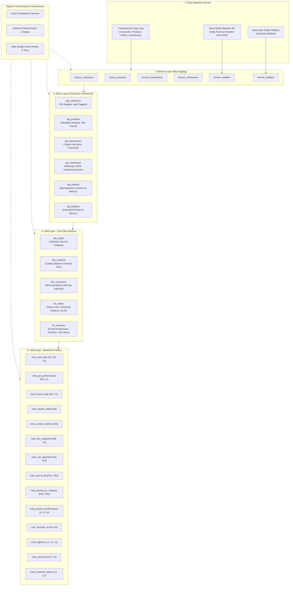
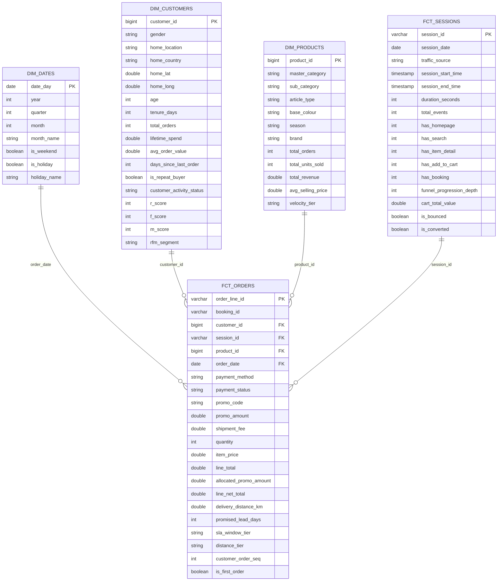

# Fashion Commerce Analytics Platform: Architecture & Detailed ETL Transformations

## 1. Executive Summary & Platform Architecture

The **Fashion Commerce Analytics Platform** is a modern, production-grade end-to-end data platform built to unify clickstream interactions, transaction records, customer demographics, catalog metadata, weather patterns, and calendar holidays into an integrated analytical warehouse.

The platform implements an in-warehouse ELT pattern using the **Medallion Architecture** (Raw &rarr; Bronze &rarr; Silver &rarr; Gold), orchestrated with **Dagster**, transformed and tested using **dbt (data build tool)**, and powered by **DuckDB** as the embedded analytical OLAP engine.

### 1.1 High-Level Architecture Diagram



---

## 2. Detailed Data Transformation Pipeline (Stage by Stage)

### Stage 1: Ingestion (Raw &rarr; Bronze)

The Bronze layer ingests operational files and external API feeds into DuckDB tables under the `bronze` schema without altering business semantics.

| Source | Target Table | Volume | Extraction Method & Transformation |
| :--- | :--- | :--- | :--- |
| `customer.csv` | `bronze.bronze_customers` | 100,000 rows | Raw CSV ingestion into DuckDB via PyArrow/polars, capturing initial registration details and customer demographics. |
| `product.csv` | `bronze.bronze_products` | 44,422 rows | Ingests product catalog, including JSON metadata strings in `product_metadata`. |
| `transactions.csv` | `bronze.bronze_transactions` | 1,254,585 rows | Ingests order lines, payment status, promotional discounts, shipping fees, and coordinates. |
| `clickstream.csv` | `bronze.bronze_clickstream` | 12,833,602 rows | High-volume mobile/web event stream capturing 9 distinct user actions. |
| Open-Meteo API | `bronze.bronze_weather` | 73,359 rows | Daily weather observations (temperature mean, precipitation) for 33 Indonesian provinces across 2016-2022. Implements exponential backoff, rate limiting, and local caching. |
| `holidays.csv` | `bronze.bronze_holidays` | 115 rows | Indonesian national public holidays list (2016-2022). |

---

### Stage 2: Cleansing, Normalization & Imputation (Bronze &rarr; Silver)

The Silver layer (dbt models under `models/staging/`, materialized in schema `silver`) applies cleansing rules, enforces data contracts, protects privacy, and imputes missing catalog attributes.

#### 1. `stg_customers`
- **PII Stripping**: Removes names, email addresses, phone numbers, and raw device identifiers to comply with GDPR/data privacy regulations.
- **Reference Date Consistency**: Uses a fixed project reference date (`2022-08-01`, defined in `dbt_project.yml`) rather than dynamic system time (`current_date`) so that calculations for age, customer tenure, and inactivity are strictly deterministic and reproducible.
- **Data Quality Flagging**: Computes `age = datediff('year', birthdate, reference_date)` and flags plausibility via `is_age_plausible` (`age >= 15`). Records with extreme ages are preserved for auditability rather than silently dropped.
- **Tenure Computation**: Calculates `tenure_days = datediff('day', first_join_date, reference_date)`.

#### 2. `stg_products`
- **JSON Metadata Extraction**: Extracts attributes embedded in JSON strings (`masterCategory`, `subCategory`, `articleType`, `baseColour`, `season`, `year`, `usage`) using a custom dbt macro (`metadata_extract.sql`).
- **Standardization & Casing**: Standardizes text case using `title_case.sql` to eliminate duplicates arising from inconsistent casing (e.g., "Casual" vs. "casual").
- **Attribute Imputation**:
  - `base_colour`: When missing, inferred from keywords in `product_display_name` (e.g., 'Black', 'Blue', 'White'); defaults to `'Unspecified'`.
  - `season`: Fallback to `'All-Season'`.
  - `usage`: Fallback to `'Casual'`.
- **Completeness Flagging**: Adds `metadata_status` (`'Complete'` vs. `'Incomplete'`) indicating whether any core attributes required imputation.

#### 3. `stg_transactions`
- **Typing & Casting**: Converts timestamps, dates, quantities (`INTEGER`), and monetary amounts (`DOUBLE`).
- **Line Item Revenue**: Calculates `line_total = quantity * item_price`.
- **Order-Level Amounts Isolation**: Documents that `promo_amount`, `shipment_fee`, and `total_amount` repeat on each line item of multi-line orders (`booking_id`), setting up proportional allocation rules in downstream models.
- **Handling Catalog Gaps**: Detects 672 orphaned transaction lines referencing `product_id`s not present in catalog, ensuring all downstream joins use `LEFT JOIN` to prevent silent revenue omission.

#### 4. `stg_clickstream`
- **Metadata Flattening**: Parses dynamic event JSON strings into typed columns (`search_keywords`, `payment_status`, `promo_code`, `promo_amount`, `quantity`, `item_price`).
- **Temporal Parsing**: Extracts `event_date` and `event_hour` for performance indexing and hourly drop-off analysis.
- **Source Classification**: Validates and normalizes `traffic_source` into `'MOBILE'` or `'WEB'`.

#### 5. `stg_weather` & `stg_holidays`
- **Location Alignment**: Normalizes provincial naming to match customer home locations exactly across all 33 Indonesian provinces.
- **Deduplication**: Enforces strict unique constraints on date-location pairs.

---

### Stage 3: Star Schema Dimensional Modeling (Silver &rarr; Gold Core)

The Gold Core models (`models/marts/core/`, materialized as tables in schema `gold`) build the central star schema optimized for analytical query performance and dimensional slicing.



#### Detailed Core Model Logic:

1. **`dim_dates`**:
   - Continuous date spine generated using DuckDB's `range(date '2016-01-01', date '2023-01-01', interval '1 day')`.
   - Joined with `stg_holidays` to attach Indonesian holiday flags and descriptions.
   - Computes calendar parts: year, quarter, month, week, day of week, day name, and weekend flag.

2. **`dim_products`**:
   - Master product catalog left-joined with lifetime sales aggregates from `stg_transactions` (`payment_status = 'Success'`).
   - Computes: `total_orders`, `total_units_sold`, `total_revenue`, and `avg_selling_price`.
   - Assigns automated sales velocity tiers:
     - `'Top Seller'`: `total_units_sold >= 100`
     - `'Steady Mover'`: `total_units_sold >= 20`
     - `'Slow Mover'`: `total_units_sold > 0`
     - `'Zero Sales'`: `total_units_sold = 0`

3. **`dim_customers`**:
   - Unified customer profile joined with successful transaction histories.
   - Computes lifetime metrics: `total_orders`, `total_units_purchased`, `lifetime_spend`, `avg_order_value`, `first_order_date`, `last_order_date`.
   - Computes inactivity days: `days_since_last_order = datediff('day', last_order_date, reference_date)`.
   - Assigns 180-day CRM lifecycle status:
     - `'Active'`: `days_since_last_order <= 90`
     - `'At Risk'`: `days_since_last_order between 91 and 180`
     - `'Lapsed'`: `days_since_last_order > 180`
     - `'Never Purchased'`: `total_orders = 0`
   - Computes RFM quintile scores (`NTILE(5)` over active buyers) and assigns marketing segments:
     - `'Champions'`: R &ge; 4 and F &ge; 4
     - `'Loyal Customers'`: R &ge; 3 and F &ge; 3
     - `'Potential Loyalists'`: R &ge; 4 and F &le; 2
     - `'Promising'`: R = 3 and F &le; 2
     - `'At Risk High Value'`: R &le; 2 and F &ge; 4
     - `'At Risk Regular'`: R &le; 2 and F in (2, 3)
     - `'Hibernating / Lost'`: R &le; 2 and F = 1

4. **`fct_orders`**:
   - Line-item grain containing 1,254,585 order lines.
   - Calculates customer purchase sequence: `customer_order_seq = dense_rank() over (partition by customer_id order by created_at, booking_id)`.
   - First-time buyer indicator: `is_first_order = (customer_order_seq = 1)`.
   - Proportional promotional allocation: `allocated_promo_amount = round(line_total / order_gross_value * promo_amount, 2)` to evaluate net product-level margins.
   - Line net revenue: `line_net_total = line_total - allocated_promo_amount`.
   - **Haversine Distance**: Computes exact geodesic distance between customer home coordinates and shipping destination coordinates:
     $$\text{Distance} = 2 \cdot R \cdot \arcsin\left(\sqrt{\sin^2\left(\frac{\Delta\text{lat}}{2}\right) + \cos(\text{lat}_1)\cos(\text{lat}_2)\sin^2\left(\frac{\Delta\text{long}}{2}\right)}\right)$$
     where $R = 6,371\text{ km}$.
   - Classifies distance tiers: `'< 50 km (Local)'`, `'50-250 km (Regional)'`, `'250-1000 km (Inter-city)'`, `'> 1000 km (Long Haul)'`.
   - SLA Lead Days: `promised_lead_days = datediff('day', created_at, shipment_date_limit)`.

5. **`fct_sessions`**:
   - Session grain summarizing 895,203 distinct user sessions from 12.8M clickstream events.
   - Calculates session duration (`datediff('second', min_event_time, max_event_time)`), click count, and scroll count.
   - Detects milestone progression flags: `has_homepage`, `has_search`, `has_item_detail`, `has_add_to_cart`, `has_booking`.
   - Tracks cart totals: `cart_items_count` and `cart_total_value = sum(quantity * item_price)` for `ADD_TO_CART` actions.
   - Evaluates session outcome: `is_bounced` (`events = 1` or `duration = 0`) and `is_converted` (successful paid booking).

---

### Stage 4: Department-Specific Analytics Marts (Gold Analytics)

The Analytics Marts (`models/marts/analytics/`, schema `gold`) aggregate core dimensions and facts into curated, pre-calculated tables addressing every business question in `docs/business_questions.md`.

| Dept | ID | Business Question | Supporting Mart | Key Transformation Logic |
| :--- | :--- | :--- | :--- | :--- |
| **Exec** | **E1** | How are revenue, orders, AOV and active customers trending (MoM, YoY)? | `mart_exec_kpis` | Aggregates distinct successful bookings by `order_month`. Computes `lag(net_revenue, 1)` for MoM and `lag(net_revenue, 12)` for YoY growth percentages. |
| **Exec** | **E2** | What share of revenue comes from new vs. returning customers? | `mart_exec_kpis` | Segregates orders via `is_first_order`, computing monthly revenue totals and share percentage (`100 * new_rev / net_revenue`). |
| **Exec** | **E3** | Which countries and regions drive revenue and growth? | `mart_geo_performance` | Groups orders by `order_month`, `home_country`, and province (`home_location`), calculating revenue rank and average delivery distances. |
| **Mktg** | **M1** | Which traffic source converts best from session to purchase? | `mart_funnel_daily` | Groups `fct_sessions` by `session_date` and `traffic_source`, calculating stage conversion rates and overall session-to-paid conversion percentage. |
| **Mktg** | **M2** | What do users search for, and which searches lead to no purchase? | `mart_search_intent` | Groups clickstream searches by lowercased query. Identifies zero-conversion keywords with &ge; 1,000 sessions (`is_zero_conversion = true`) as catalog assortment gaps. |
| **Mktg** | **M3** | How do customer cohorts retain over 1, 3, 6 and 12 months? | `mart_cohort_retention` | Defines cohort by `first_order_date` month, tracks repeat activity at `month_number = datediff('month', cohort_month, order_month)`, computing retention % and cumulative revenue per user. |
| **Mktg** | **M4** | How large is each RFM segment and what is its revenue share? | `mart_rfm_segments` | Aggregates customers by `rfm_segment`, computing customer count share %, total revenue share %, average recency, and order frequency. |
| **Prod** | **P1** | Where do sessions drop off in the conversion funnel? | `mart_funnel_daily` | Calculates step-by-step transition rates: Home &rarr; Search &rarr; Detail &rarr; Cart &rarr; Booking &rarr; Paid. |
| **Prod** | **P2** | How do session length and events differ by device/source? | `fct_sessions` | Granular session-level facts with `duration_seconds`, `duration_tier`, and event counts sliced by traffic source. |
| **Prod** | **P3** | What is the cart-to-booking rate and lost cart revenue? | `mart_cart_abandonment` | Filters sessions where `has_add_to_cart = 1`. Calculates abandonment rate % and sums `cart_total_value` for non-converted sessions (`lost_revenue_abandoned_cart`). |
| **Price**| **PR1**| What is the promo lift (order value, conversion) by promo code? | `mart_promo_lift` | Compares order counts, gross/net AOV, and discount depth across individual promo codes versus the `NO_PROMO` baseline. |
| **Price**| **PR2**| Do new customers rely on promos more than returning customers? | `mart_promo_lift` | Evaluates promo adoption share within cohorts (`is_first_order`), comparing new vs returning discount depths. |
| **Price**| **PR3**| What is the gross-to-net revenue gap per category? | `mart_pricing_by_category` | Aggregates `allocated_promo_amount` by `master_category`, computing the margin gap percentage (`100 * promo_cost / gross_revenue`). |
| **Price**| **PR4**| How do price points per article type relate to units sold? | `mart_pricing_by_category` | Categorizes order lines into 5 price bands (Budget to Luxury) to analyze sales elasticity by article type. |
| **Merch**| **I1** | Which categories and article types are top vs. slow movers? | `mart_product_performance` | Combines unit sales and orders from `fct_orders`, categorizing catalog items into velocity tiers. |
| **Merch**| **I2** | What is the view/cart to purchase rate per product? | `mart_product_performance` | Joins clickstream `ADD_TO_CART` volume with transaction purchase volume to flag high-cart/zero-purchase items for repricing or re-photography. |
| **Merch**| **I3** | How does demand shift by season, holiday and weather? | `mart_demand_drivers` | Merges daily category sales with `stg_weather` (`temp_mean_c`, `precip_mm`) and `dim_dates` (`is_holiday`, `is_weekend`) by location. |
| **Merch**| **I4** | Which brands and colours gain or lose share over time? | `mart_product_performance` | Catalog performance sliced by `brand` and `base_colour` with first and last sale dates. |
| **Logist**| **L1** | How do shipment fees vary by destination and order share? | `mart_logistics` & `mart_geo_performance` | Calculates shipment fee percentage of order gross value (`100 * shipment_fee / order_gross_value`) across provinces. |
| **Logist**| **L2** | What is the distribution of promised delivery windows? | `mart_logistics` | Calculates `promised_lead_days` and categorizes orders into SLA window tiers (`'< 3 days'`, `'3-5 days'`, `'6-7 days'`, `'> 7 days'`). |
| **Logist**| **L3** | How far do orders travel from customer home? | `mart_logistics` | Calculates geodesic travel distance in kilometers via the Haversine formula and buckets into regional/long-haul tiers. |
| **Fin**  | **F1** | What is payment success vs. failure rate by method? | `mart_payments` | Groups booking attempts by `order_month` and `payment_method`, calculating success and failure percentages. |
| **Fin**  | **F2** | How much revenue is lost to failed payments and do customers retry? | `mart_payments` | Sums `total_amount` for failed payments and tracks retry attempts and eventual retry success rates using window functions (`lead(payment_status)`). |
| **Fin**  | **F3** | What are net revenue, promo cost and shipping revenue per month? | `mart_exec_kpis` | Deduplicates booking financials to report monthly gross revenue, total promotional discounts, net revenue, and collected shipping fees. |
| **CRM**  | **C1** | Which customers are active, at risk or lapsed (180-day rule)? | `mart_customer_status` | Evaluates customer inactivity against the reference date, segmenting into Active (&le; 90d), At Risk (91-180d), and Lapsed (&gt; 180d). |
| **CRM**  | **C2** | What are repeat purchase rates and time between orders? | `mart_customer_status` | Flags repeat purchasers (`total_orders > 1`) and calculates average days between orders: `datediff('day', first_order, last_order) / (total_orders - 1)`. |
| **CRM**  | **C3** | What is the LTV distribution by segment, gender and country? | `mart_rfm_segments` | Computes parametric and non-parametric LTV metrics (average, median, 25th, 75th, 90th percentiles) across segments. |

---

## 3. Data Quality, Testing & Governance

### 3.1 Automated dbt Test Suite
The platform executes **122 automated validations** across staging and marts upon every run:
- **Primary Key Uniqueness & Not-Null**: Validated on all dimensional keys (`customer_id`, `product_id`, `date_day`), fact keys (`order_line_id`, `session_id`, `booking_id`), and mart grains (`order_month`, `search_keyword`).
- **Accepted Value Contracts**: Enforced on statuses (`payment_status` in `['Success', 'Failed']`), traffic channels (`['MOBILE', 'WEB']`), customer statuses, and velocity tiers.
- **Referential Integrity**: Relationship tests linking orders to customers and products. Configured with a `warn` threshold on `stg_products` to safely account for upstream orphaned products without terminating downstream runs.
- **Test Results**: 121 Passed, 1 Warning (known 672 orphaned products in raw catalog), 0 Failures.

### 3.2 SQL Style & Linting Compliance
All SQL models comply with **SQLFluff** rules configured specifically for DuckDB dialect and Jinja templating:
- Uppercase keywords and functions (`SELECT`, `LEFT JOIN`, `COALESCE`, `COUNT`).
- Lowercase table and column identifiers.
- Leading commas and leading binary operators (`+`, `*`, `AND`, `OR`).
- Strict line length (&le; 120 characters) and single trailing newline enforcement.

### 3.3 Dagster Orchestration Lineage
In Dagster (`orchestration/definitions.py` and `orchestration/assets/dbt.py`), **31 Software-Defined Assets** form a continuous lineage:
- **6 Bronze Assets**: Raw ingestion jobs with row count verification.
- **6 Silver Assets**: Staging dbt transformations and data cleaning contracts.
- **5 Gold Core Assets**: Star schema dimensions and facts.
- **14 Gold Analytics Assets**: Department-level marts ready for consumption by Streamlit dashboards and BI tools.

---

## 4. Runbook & Verification Commands

### Execute Pipeline via dbt
```bash
# Move into dbt directory
cd dbt_project

# Compile and validate models
uv run dbt compile --profiles-dir .

# Run all staging models and tests
uv run dbt build --select staging --profiles-dir .

# Run core star schema and tests
uv run dbt build --select marts.core --profiles-dir .

# Run department analytics marts and tests
uv run dbt build --select marts.analytics --profiles-dir .

# Run full project build (all 25 models + 97 tests)
uv run dbt build --profiles-dir .
```

### Format & Lint Code
```bash
# Lint dbt SQL models
uv run sqlfluff lint dbt_project/models

# Automatically format SQL models
uv run sqlfluff fix dbt_project/models

# Run python unit tests
uv run pytest
```

### Launch Dagster Orchestration
```bash
# Restart Dagster services in Docker
docker compose restart dagster

# View live execution logs
docker logs -f fashion-commerce-analytics-platform-dagster-1
```
The Dagster UI is available at `http://localhost:3000`, providing real-time visibility into asset dependencies, execution logs, and materialization histories.
